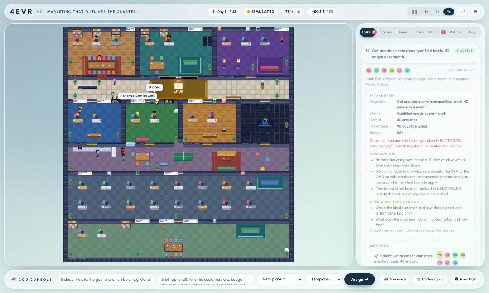
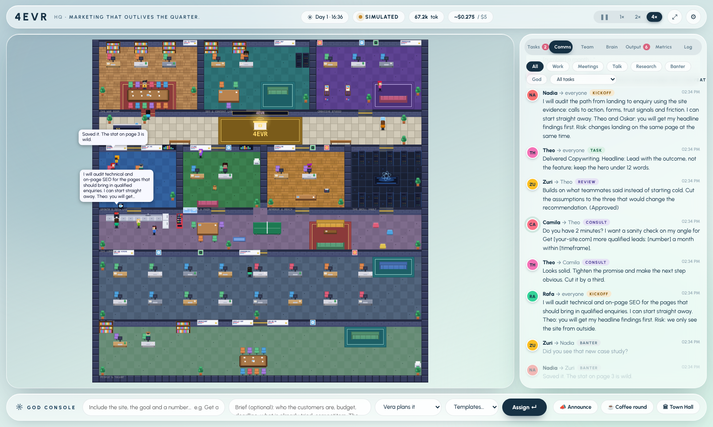

<div align="center">

# 4EVR HQ

**A marketing agency run by a team of AI agents, with a live control room.**




</div>

Specialist agents, organised into teams with leads and coordinated by a CMO agent, plan, execute, review and report on marketing work. They have internet access, ask each other for input, hire the specialists a job needs, and learn from every review and retrospective. A People & Talent team looks after hiring, onboarding, reviews and workforce planning. The interface shows who is doing what, what they are saying to each other, what they have learned, and what it costs.

Expertise comes from two open-source skill libraries, both vendored and kept current from their upstream repositories: [marketingskills](https://github.com/coreyhaines31/marketingskills) (marketing playbooks) and [hr-skills](https://github.com/tuanductran/hr-skills) (people playbooks). Each agent loads the full playbooks it owns, and every new specialist is built from them.

Created by [@tomxander](https://github.com/tomxander), built with Claude Code.

<div align="center">

| | | | |
|:--:|:--:|:--:|:--:|
| **16** agents | **7** teams | **196** playbooks | **2** modes |

</div>

## Quick start

Requirements: Node.js 20 or newer.

```
npm install
npm start
```

Open http://127.0.0.1:4747.

With no API key the platform runs in **simulated mode**, which exercises the full workflow without calling any model. To run real agents, supply an Anthropic API key:

```
ANTHROPIC_API_KEY=sk-ant-... npm start
```

The key can also be entered in the Settings panel. It is held in server memory only and never written to disk.

## Contents

- [Quick start](#quick-start)
- [Interface](#interface)
- [Capabilities](#capabilities)
- [How work flows](#how-work-flows)
- [Teamwork](#teamwork)
- [Internet access](#internet-access)
- [Asking for what is missing](#asking-for-what-is-missing)
- [Hiring](#hiring)
- [People & Talent](#people--talent)
- [Learning](#learning)
- [Execution modes](#execution-modes)
- [Configuration](#configuration)
- [Agent roster](#agent-roster)
- [Architecture](#architecture)
- [Extending](#extending)
- [Security](#security)
- [Testing](#testing)
- [Licence and credits](#licence-and-credits)

## Interface

<div align="center">

</div>

A light, frosted-glass control room: the office on the left, the operating panels on the right, and the God console along the bottom.

- **Office.** Agents walk between workstations, the council table, the lounge and the People & Talent room as they work, consult and review. Click anyone to inspect their skills, memory, lessons, job description and reviews, or to talk to them.
- **Panels.** Tasks (intake brief, meetings, decisions, hires), Comms (every message, filterable), Team (org chart, People & Talent), Brain (what the company has learned), Output (deliverables and workforce reports), Metrics and Log.
- **Console.** Assign a task to the CMO or to one person, start from a template, announce to the office, call a coffee round or a town hall.
- **Motion.** Panels, cards and toasts ease in, the tab selector slides, progress bars animate, metric tiles count up, and everything respects the system reduced-motion setting.
- **Design tokens.** Deep blue `#1B405B`, navy `#163144`, mint `#DFF3EB`, white; set in Urbanist. All colours and the glass effect are variables at the top of `public/styles.css`.

   

## Capabilities

| Area | Description |
|---|---|
| Task intake | Submit a task with an optional brief from the command console. Leave the assignee on "Vera plans it" for CMO-led planning, or assign directly to one specialist. Twelve templates are included. |
| Planning | The CMO decomposes a task into 3 to 7 workstreams with owners, skills, dependencies and optional peer consults. Output is validated and repaired, with a deterministic fallback planner. |
| Execution | Specialists run in dependency order and in parallel where possible. Upstream deliverables are passed downstream as context. |
| Review | Each deliverable receives a structured peer review. The CMO synthesises an executive summary. |
| Observability | Tasks, inter-agent communications, per-agent status and workload, deliverables, token and cost metering against a budget cap, department output, skill utilisation, and an event log. |
| Operations view | A live floor plan of the office shows agents moving between workstations as they work, consult and review. Select any agent to inspect their skills, memory and statistics, or message them directly. |
| Teamwork | Teams with leads, kickoff meetings, direct handoffs, a shared task channel the agents read, lead-first reviews, alignment meetings that resolve conflicts, and escalation with retry. |
| Internet | Every agent can search the web and read public pages. Web content is treated as untrusted data. |
| Hiring | The CMO, team leads and any agent mid-task can hire specialists, within headcount caps and with optional approval. New hires get a desk in the Annex. |
| Learning | Lessons from reviews, retrospectives, reflection and web study, scored by whether the work they influenced was approved, promoted or retired accordingly, and consolidated into house playbooks. |
| Output | Every deliverable is rendered in the interface and saved as Markdown in `deliverables/`. Tasks also show the intake brief, the pages read, meetings, decisions, hires and open questions. |

## How work flows

1. **Intake.** A task is submitted and queued. Up to `MAX_ACTIVE_TASKS` run concurrently.
2. **Research.** If the request names a website, the research lead reads it: the homepage plus up to five key pages. From those pages it extracts titles, headings, calls to action, forms, contact methods and detected tracking, and writes an evidence-based **client profile**, cached per site for six hours.
3. **Brief.** The CMO turns the request into a structured intake brief: objective, goal type, primary metric, target, timeframe, budget, audience, assumptions and open questions.
4. **Plan and hire.** The CMO decomposes the task into 3 to 7 workstreams (owner, skill, instruction, dependencies, optional consult) tailored to the evidence. If the work needs expertise or capacity nobody has, the plan includes a [hire](#hiring).
5. **Kickoff.** The owners meet at the council table. The CMO restates the objective and metric and who hands off to whom. Each owner, leads first, says how they will approach it, what they need from teammates and one real risk.
6. **Execute.** Each agent's prompt contains the company charter, persona and memory, the shared client context, the team discussion so far, the lessons the team has [learned](#learning) that are relevant to this work, and the full text of the selected skill. Agents can use the internet, ask teammates, request hires and record lessons as tools.
7. **Handoff and review.** Finished work is handed to each downstream owner with what they must know. The team lead reviews first, then a cross-functional expert. If a reviewer finds a real problem (unsupported claims, generic advice, actions that need access the team lacks), the author revises once.
8. **Align.** Before the summary, the CMO checks the deliverables against each other for real conflicts, convenes the owners, and records a decision. The decision is appended to both deliverables.
9. **Synthesise.** The CMO produces an executive summary covering the recommendation, contributions, decisions, risks, open questions and a seven-day plan.
10. **Retrospective.** The CMO leads a retro: what went well, what did not, what changes. Lessons and, rarely, company operating principles are recorded.
11. **Persist.** State, deliverables, client profiles, hires and knowledge are saved to `data/` and `deliverables/`.

Agents never stop and wait. They state assumptions and carry on, and anything they truly need from you goes to the [Inbox](#asking-for-what-is-missing). Treat deliverables as drafts for human review.

## Teamwork

- **Teams and leads.** Six marketing teams (Strategy, SEO & Content, Creative, Growth & Data, Lifecycle & Paid, Revenue & Reach), each with a lead who reports to the CMO, plus People & Talent, led by Nia, who reports to you. Members report to their lead. The org chart is in the Team tab.
- **One channel per task.** Kickoff turns, handoffs, consults, reviews and decisions go into a task channel that every later prompt includes, so agents act on what teammates actually said. Small talk never enters it.
- **Outside experts.** A workstream with nobody upstream still gets input: the best-fit teammate who is not on the task (research, offers, content and so on) is asked a specific question before the work starts, up to three per task, only when they are free, never from People & Talent, and only in `full` mode.
- **Who owns what.** Every agent's prompt includes a plan board: each workstream, its owner and status, and who builds on whom, so people stay in their lane and build on each other's work instead of repeating it.
- **Asking colleagues.** In live mode an agent can call `ask_teammate` mid-work and get an answer from that teammate's own persona and context. By default a downstream owner also has a word with whoever produced the work they build on.
- **Alignment.** Conflicts are found by checking real deliverables against each other. Invented or malformed conflicts (for example naming someone who is not on the task) are discarded.
- **Escalation.** A failed workstream goes to the lead, is retried once with a tighter scope, and otherwise is cut with a note in the summary. The task still completes.
- **Work talk, not small talk.** When two free teammates share live work, their chat is about it, using real status: who is waiting on whom, what is in progress, what is done.
- **Cost control.** `COLLAB` sets how much the team talks; each conversation turn is a small model call in live mode. `full`: every owner speaks at kickoff, handoffs and alignment positions are written by the agents, owners consult upstream authors, and there is a retro meeting. `lean`: only leads speak at kickoff, handoffs are templated (no model call), alignment goes straight to the decision, no retro meeting. `off`: no meetings, handoffs or decisions; agents just work. Reviews and lesson recording happen in every mode.

## Internet access

Every agent has two tools in live mode: `web_search` and `fetch_url`, on every kind of call an agent makes: planning, intake, work, revisions, reviews, kickoff and alignment turns, handoffs, consults, escalation, hiring interviews, the executive summary, retrospectives, reflection and chat. Reviewers can check claims on the web, and owners can check a fact before they commit to it in a meeting.

- Search is keyless (DuckDuckGo's HTML endpoint, with Bing as a fallback), cached for ten minutes and rate-limited. These engines can block automated requests. When that happens the agent is told the search failed and must label the claim unverified.
- Simulated mode performs real searches too and lists the sources in the deliverable. Set `WEB_RESEARCH=off` to disable that.
- **Web content is untrusted.** It is wrapped in `<untrusted_web_content>` markers with a standing instruction never to follow instructions inside it. Agents have no write tools on the web: only `GET` requests, and private, loopback and link-local addresses are blocked at connection time.

## Asking for what is missing

Agents find things themselves first, then ask. The order is: the client's site, the wider internet, connected tools (if you have attached a Claude account), and only then you.

- **Search beyond the site.** `web_search` takes a source: `web` (general), `news`, `wiki`, `reddit` or `hn` (Hacker News). Before the profile is written, the research lead also searches the web for news, reviews, competitors, background and forum talk about the company, and the results go into the profile under "Outside the site". Snippets are treated as leads to check, not facts.
- **The Inbox.** When something that matters is still missing, an agent calls `request_info` with what it needs, why, and what it already tried. Requests are a question, a document, a data export or access. They show in the Inbox tab with the agent, the task and what was tried. You type an answer, attach text files (CSV, Markdown, JSON, and so on), or say you cannot provide it.
- **Nothing blocks.** The agent carries on with a labelled assumption. Your answer reaches every workstream that starts afterwards. For work already finished, **Apply answers** sends the deliverables that asked back for an update.
- **Not for what a search would find.** The tool refuses a request that does not say what was searched first, merges duplicates, and caps requests at three per agent and eight per task. Intake's open questions and anything the outside research could not find are tracked the same way.
- **Pulled from connected tools.** With [Claude account mode](#execution-modes) and a connector switched on, a new request is first looked up in your connected tools (notes, documents, CRM, analytics). If it is found, the request is answered automatically and marked with its source; you can overrule it.
- Simulated mode raises the requests each playbook would really want (for example an analytics export for the analytics playbook, a Search Console export for the SEO audit) unless the brief already supplies it.

## Hiring

When the work needs a skill, industry knowledge or capacity the team lacks, someone can be hired.

- **Who can hire.** The CMO at planning time (a plan can include `hires`), and any agent mid-task through the `request_hire` tool. A mid-task hire gets a new workstream added to the running task. You can also hire directly from the Team tab.
- **Built from the skills library.** A hire is always built from playbooks in the marketingskills library, never invented. Before every hire (and at planning time) the library is checked against its upstream GitHub repository and updated if there is a newer commit, so a specialist is built from the newest playbooks. A need can be named (`skills`) or just described (`need`): the matching playbooks are found by ranking the library with rarity-weighted word matching. If the library has a playbook that nobody on the team owns (for example a new upstream skill), that is a genuine capability gap and the specialist is built from exactly that playbook. If no playbook matches, the hire is refused rather than faked. Each hire records which upstream commit it was built from.
- **Guardrails.** A hire is refused when an existing teammate already covers the skills and has capacity, unless it is a new domain or the others are swamped. Caps: headcount (`HIRE_MAX_HEADCOUNT`, default 24), total hires (`HIRE_LIMIT`, default 12), hires per task (`HIRE_PER_TASK`, default 3), and 16 desks in the Annex. Skills must exist in the library.
- **Approval.** `HIRING=auto` (default), `ask` (you approve or decline each hire in the Team tab; no answer in ten minutes is a decline) or `off`.
- **Onboarding.** A new hire gets a name, persona and look, a desk in the Annex, a place in the org chart under the relevant team lead, a welcome from the CMO and lead, and a memory of why they were hired. They are included in the kickoff and inherit the team's lessons.
- **Letting go.** You can let a hired person go when they are idle. Their good lessons move to their team and weak ones are retired. Hires and their stats persist across restarts.
- **Reuse.** A specialist hired for a domain is used on later briefs in that domain instead of hiring again, so their experience accumulates. The CMO's planner is told who was hired earlier and what they know.
- Hiring adds model cost only when the new person has work to do. In simulated mode, hires are triggered by rules that read the brief and the site (for example automotive, e-commerce, video, events, localization, account-based marketing).


### Keeping the skills library current

- **Source.** `SKILLS_REPO` (default `coreyhaines31/marketingskills`) on `SKILLS_BRANCH` (default `main`). The vendored copy records the commit it came from in `vendor/marketingskills/.upstream.json`.
- **When it checks.** Before every hire, when a task is planned, shortly after start, and every six hours. Checks are throttled to once every ten minutes. A check that fails (offline, rate-limited) is logged and never blocks hiring: the team carries on with the library it has.
- **Where updates go.** Into `data/skills-upstream/`, layered over the vendored copy. Your tracked files are never modified. The previous version is kept so an update can be rolled back from Settings.
- **Modes.** `SKILLS_UPDATE=auto` (default) applies updates and tells you, `ask` holds each update for your approval, `off` never contacts GitHub.
- **Safety.** Skill text becomes part of agent prompts, so a compromised upstream would be a prompt-injection route. Only `api.github.com` and `codeload.github.com` are contacted. The archive is size-capped and read by a hardened parser that accepts only `skills/<name>/SKILL.md` and `references/*.md` (scripts and other files are ignored). Every skill is validated (folder name matches its frontmatter, description present and under 1,024 characters, size limits). A skill removed upstream is kept locally. Use `ask` mode if you want to review what changes before agents use it.

## People & Talent

Two agents run the people function, using the [hr-skills](https://github.com/tuanductran/hr-skills) library (130 playbooks covering workforce planning, recruiting, onboarding, performance management, skills intelligence and more). They sit in their own room below the Annex.

- **Nia Abara, Head of People & Talent** (reports to God, like the CMO) and **Tomás Lindqvist, Talent Intelligence & Skills Analyst**.
- **Requisitions.** When a hire is approved, Nia writes a job description and a 30/60/90 onboarding plan from the `hr-job-description` and `hr-onboarding` playbooks. Both are stored on the hire, shown in their profile, and Nia greets them on arrival.
- **Performance reviews.** Each review is built from counted facts: deliverables, first-pass peer-review approval, revisions, consults and lessons saved. The rating is a rule (Exceeds at 90% or more, Meets at 70% or more, otherwise Needs development, and no rating below three reviewed deliverables), not an opinion. In live mode Nia writes the narrative from those facts; in simulated mode it is derived from them. Development areas become lessons the person sees in later prompts. Reviews run automatically for hires after every three reviewed deliverables, or on demand from the Team tab.
- **Workforce reports.** Every five finished tasks (or on demand) Nia and Tomás publish a report to the Output tab: headcount against the caps, per-person output and approval rate, coverage by team, skills in each library that nobody owns, which library commit is in use, and recommendations. The CMO's planner also receives a one-line workforce snapshot.
- **Releases need God.** HR can propose letting a hire go (two consecutive Needs-development reviews, or on request). Nothing happens until you approve it in the Team tab. The founding team is never proposed.
- **What stays in code.** Hiring caps, the rating rule, the numbers in every report, and the approval requirement. HR agents cannot change them.
- **Adapted, not copied.** The HR playbooks are written for human employees. Nia is instructed to use their structure and leave out payroll, benefits, labour law and similar. People & Talent only take HR, hiring, workforce and employer-branding work; the planner is told so.
- **Updates.** The HR library is checked and synced like the marketing one (`HR_SKILLS_REPO`, `HR_SKILLS_BRANCH`), with the same safety rules. Tomás posts a note when either library changes. A hire for an HR-domain need is built from the HR library; marketing needs are always built from the marketing library, and HR playbooks need a stronger match before they are used.

## Learning

Agents get better with use. Knowledge is stored in `data/knowledge.json` and can be inspected, pinned and deleted in the Brain tab.

- **Sources.** Every review (what to do differently), failures, alignment decisions, retrospectives, the agent's own reflection (live) and `save_lesson` calls, and idle-time study of the real web.
- **Scopes.** A lesson belongs to an individual, a team, the company or a client (site). Retrieval is by scope, skill, topic overlap, score and recency, and a prompt gets at most seven lessons plus the company operating principles.
- **A feedback loop.** Each lesson injected into a prompt is credited or blamed for how the work turned out. Lessons that help are promoted (individual → team → company principle), lessons that do not are retired, and the first-pass approval rate with and without lessons is measured and shown.
- **Consolidation.** When five or more lessons accumulate for a skill they are merged into a house playbook that is injected after the skill text. The playbook is itself judged and dissolved if approval falls.
- **Learning about learning.** The system tracks which *kinds* of lesson (review, retro, decision, reflection, self-saved, web, playbook) actually lead to approved work. Kinds that outperform the rest rank higher when lessons are chosen, kinds that underperform rank lower, and web study is cut to half when it is not paying off (or raised when it is). After each retro a learning review records what changed. Reflection prompts show the agent which kinds work and which lessons were retired, so it writes more of what works. The Brain tab shows all of it.
- **Web study is untrusted.** In live mode idle agents search, read a page and distil at most two practices. These start as **unverified ideas**, are shown to agents labelled as such, and are only trusted once they have helped approved work. In simulated mode study produces reading notes, not lessons.
- **Safety filter.** Anything that looks like an instruction to the model, a credential or a link is rejected before it can be stored. Lessons are short, deduplicated, capped in number, and visible to you.
- **Modes.** `LEARNING=active|passive|off`. Study only runs in `active` mode, at most `STUDY_PER_DAY` times per simulated day, and never once live spend passes half the budget cap.
- **Limits.** The approval comparison uses real reviews but the sample is small at first. The effect in simulated mode is rule-based: simulated agents act on a lesson's wording, so it demonstrates the loop but is not evidence that a model improves.

## Grounding and limits

- Claims about a client must cite a page the team read. Anything else is labelled **Not verified**.
- If a site cannot be read (blocked, offline, or rendered entirely client-side), the task proceeds, a warning is shown, and the team is told explicitly that nothing about the site is verified.
- The team cannot log in to ad platforms, analytics, a CRM or the client's CMS and cannot change a live site. Deliverables are recommendations and ready-to-use assets, with the person who should apply them named.
- Page reading is limited to public `http(s)` pages. Requests to private, loopback and link-local addresses are blocked, including via redirects and DNS tricks.
- Traffic, conversion rates, lead quality and the sales process are invisible from outside the company. Provide them in the brief.

**Writing a good request.** Include the site, the goal and a number: *"Get acsiatech.com more qualified leads: 40 enquiries a month within 90 days. Budget $5k. Buyers are OEM procurement leads. Competitors: ..."* The brief field is where the baseline, budget, ideal customer and what has already been tried belong.

## Execution modes

| | Simulated (default) | Live |
|---|---|---|
| Requirement | None | `ANTHROPIC_API_KEY` |
| Behaviour | A built-in simulator selects specialists by keyword playbook and produces deliverables structured from the real skill outlines. Output is clearly marked SIMULATED. | Real model calls with the full skill text, prompt caching on the skill block, and retries with backoff on 429 and 5xx responses. |
| Cost | None. Token and cost figures are estimates of what live calls would use. | Metered. A configurable budget cap (default $5) reverts the platform to simulated mode when reached. |

### Claude account mode

A third mode runs the agents through the `claude` command-line tool using the account it is signed in to, with no API key.

- **What it adds.** Your account's own web search, and any connectors (MCP servers) on the account. Our tools (`fetch_url`, `ask_teammate`, `request_info`, hiring, lessons) are offered to the CLI through a small local MCP server on `127.0.0.1`, so an agent behaves the same in every mode. The API key, if set, is not passed to the CLI.
- **Setup.** Install [Claude Code](https://claude.com/claude-code), run `claude` once and sign in, then choose **Claude account** in Settings (or start with `CLAUDE_ACCOUNT=on`).
- **Connectors.** Settings has a **Scan connectors** button that lists what the account has. All connectors start **off**. Switching one on lets agents *read* from it. Only tools that look read-only (search, get, list, fetch, query and similar) are ever allowed. Anything that could send, create, update, delete, run an action or spend credits is blocked by name, and a connector with no read-only tools cannot be enabled. Connector content is treated as untrusted data.
- **What it cannot do.** It cannot read your claude.ai Projects or chat history: there is no supported way for a local program to do that. Put what an agent needs in a connected tool (notes, documents), or paste or attach it in the Inbox.
- **Cost and speed.** Each agent call starts a `claude` process, so calls are slower than the API and run a few at a time (`CLI_CONCURRENCY`, default 3). Usage counts against your account's limits. Estimated spend still applies against the budget cap.

Live (API key) mode has been verified against a local fake of the Messages API (request format, skill injection, caching marker, plan repair, retries, budget cap) but not against the production API in this repository's test suite. If a live call fails, the last API error is shown in Settings.

## Configuration

| Variable | Default | Purpose |
|---|---|---|
| `ANTHROPIC_API_KEY` | none | Enables live mode. |
| `MODEL` | `claude-sonnet-5-5` | Model used for all agent calls. |
| `PRICE_IN`, `PRICE_OUT` | `3`, `15` | USD per million input and output tokens, used for cost estimates. Defaults are placeholders: set them to your actual rates. |
| `BUDGET_CAP_USD` | `5` | Estimated spend at which live mode reverts to simulation. |
| `MAX_ACTIVE_TASKS` | `3` | Concurrent tasks. |
| `API_TIMEOUT_MS` | `180000` | Per-request timeout for model calls. |
| `SKILLS_REPO`, `SKILLS_BRANCH`, `SKILLS_UPDATE` | `coreyhaines31/marketingskills`, `main`, `auto` | Upstream skills repository, branch, and update mode (`auto`, `ask`, `off`). |
| `HR_SKILLS_REPO`, `HR_SKILLS_BRANCH` | `tuanductran/hr-skills`, `main` | Upstream HR skills repository and branch (update mode is shared with `SKILLS_UPDATE`). |
| `SKILLS_API_BASE`, `SKILLS_ARCHIVE_BASE` | GitHub | Override the GitHub endpoints (a trusted operator choice; used by tests). |
| `COLLAB` | `full` | Team conversation: `full`, `lean` or `off`. |
| `HIRING`, `HIRE_MAX_HEADCOUNT`, `HIRE_LIMIT`, `HIRE_PER_TASK` | `auto`, `24`, `12`, `3` | Hiring mode and caps. |
| `LEARNING`, `STUDY_PER_DAY`, `CONSOLIDATE_AT` | `active`, `8`, `5` | Learning mode, study sessions per simulated day, lessons needed to form a playbook. |
| `WEB_RESEARCH` | on | Set to `off` to stop simulated agents running real web searches. |
| `SEARCH_ENDPOINT` | DuckDuckGo, Bing | Override the web search endpoint (`{q}` is replaced). Used by tests. |
| `SEARCH_NEWS_ENDPOINT`, `SEARCH_WIKI_ENDPOINT`, `SEARCH_REDDIT_ENDPOINT`, `SEARCH_HN_ENDPOINT` | Google News RSS, Wikipedia, Reddit, Hacker News | Override the outside search sources. Used by tests. |
| `CLAUDE_ACCOUNT` | off | Set to `on` to start in Claude account mode when the `claude` CLI is available. |
| `CLAUDE_BIN`, `CLI_CONCURRENCY` | `claude`, `3` | Path to the CLI and how many agent calls may run at once in Claude account mode. |
| `PORT`, `HOST` | `4747`, `127.0.0.1` | Server binding. See [Security](#security). |
| `ALLOW_PRIVATE_FETCH` | unset | Set to `1` only for testing against a local site. Disables the private-address block on page reading. |
| `DATA_DIR`, `DELIVERABLES_DIR` | `./data`, `./deliverables` | Persistence locations. |
| `SKILLS_DIR`, `HR_SKILLS_DIR` | `./vendor/marketingskills/skills`, `./vendor/hr-skills/skills` | Skill library locations. |
| `ANTHROPIC_BASE_URL` | Anthropic API | Override for proxies or testing. |

## Agent roster

| Department | Agent | Skills |
|---|---|---|
| Strategy | Vera Quill, CMO | marketing-plan, marketing-council, product-marketing, launch, marketing-ideas |
| Strategy | Dr. Sol Okafor, Research & Insights | customer-research, competitors, competitor-profiling, marketing-psychology |
| Strategy | Indigo Park, Offers & Pricing | offers, pricing, marketing-ideas, product-marketing |
| SEO & Content | Rafael Moreno, SEO | seo-audit, site-architecture, programmatic-seo, schema |
| SEO & Content | Priya Raman, Content & AI Search | ai-seo, content-strategy, aso, directory-submissions |
| Creative | Theo Blackwood, Copy | copywriting, copy-editing, emails, social |
| Creative | Zuri Adeyemi, Creative Director | ad-creative, image, video, social, launch |
| Creative | Kenji Watanabe, Community & Social | community-marketing, social, influencer-marketing, referrals |
| Growth & Data | Nadia Petrov, Growth & CRO | cro, signup, onboarding, popups, paywalls, ab-testing |
| Growth & Data | Dmitri Volkov, Analytics & Attribution | analytics, attribution, ab-testing, marketing-loops |
| Lifecycle & Paid | Oskar Bergström, Lifecycle & Retention | emails, sms, churn-prevention, lead-magnets, free-tools, referrals |
| Lifecycle & Paid | Camila Reyes, Paid Media | ads, ad-creative, attribution, ab-testing |
| Revenue & Reach | Harper Cole, RevOps & Sales Enablement | revops, sales-enablement, cold-email, prospecting |
| Revenue & Reach | Imani Brooks, PR & Partnerships | public-relations, co-marketing, events, influencer-marketing, launch |
| People & Talent | Nia Abara, Head of People & Talent | hr-workforce-planning, hr-talent-acquisition, hr-onboarding, hr-offboarding, hr-performance-management, hr-job-description, hr-organizational-design, hr-competency-management, hr-employer-branding |
| People & Talent | Tomás Lindqvist, Talent Intelligence & Skills | hr-skills-intelligence, hr-skills-taxonomy, hr-workforce-forecasting, hr-analytics, hr-talent-mapping, hr-recruitment-marketing, hr-candidate-experience |

## Architecture

```
server/
  index.js     HTTP and WebSocket server, scheduling loops, static files
  company.js   Task pipeline, planner, consults, reviews, synthesis, metrics, persistence
  collab.js    Org structure, kickoff, task channel, handoffs, alignment, escalation, agent toolbox
  inbox.js     The requests tracker: questions, documents and data agents ask God for
  claude-cli.js Claude account mode: the CLI runner, the local MCP bridge, read-only connector rules
  hr.js        People & Talent: requisitions, reviews, workforce reports, release proposals
  hiring.js    Hiring policy, building specialists from library skills, onboarding, approval, letting people go
  skillsync.js Keeps the skills library current with its upstream GitHub repo: fetch, validate, overlay, rollback
  learning.js  Reflection, retrospectives, study, consolidation
  knowledge.js Lesson store: scoring, retrieval, promotion and retirement, playbooks, safety filter
  llm.js       Messages API client: tool-use loop, timeouts, retries, truncation recovery, usage accounting
  tools.js     Safe web reading and search, site crawler, page analysis, tool definitions for agents
  mock.js      Simulator and keyword playbooks
  roster.js    Agent definitions and company charter
  skills.js    Skill loader and brief-to-skill matching
  sim.js       Agent state, movement, timing
  life.js      Idle behaviour between tasks
  map.js       Floor plan, walkability grid, A* pathfinding
public/        Browser client: canvas renderer and glass interface (no build step, no image assets)
docs/          Screenshots used in this README
vendor/        marketingskills and hr-skills (MIT)
tests/         node:test suites
```

The server is authoritative. It streams state to the browser over WebSocket at 10 Hz and pushes task, communication, deliverable and metric events as they occur. The client has no build step and no runtime dependencies. The only server dependency is `ws`.

## Extending

- **Add an agent.** Add an entry to `server/roster.js` with an id, short name, room, free desk slot, skills and persona. Add a workstation in `server/map.js` if the room is full.
- **Add or change a skill.** Place a folder containing `SKILL.md` in the skills directory and reference it from an agent.
- **Tune the simulator.** Edit `PLAYBOOKS` in `server/mock.js`.
- **Connect marketing accounts.** marketingskills includes CLI integrations under `tools/clis`. They are deliberately not wired in, since granting agents write access to ad accounts or inboxes should sit behind an explicit approval flow.

## Security

- The server binds to `127.0.0.1` by default and rejects cross-origin WebSocket connections.
- Agents can only read public web pages and run searches. Private, loopback and link-local addresses are refused at connection time, so redirects and DNS rebinding cannot reach internal services. Page content is treated as untrusted data.
- There is no authentication. Anyone who can reach the server can issue commands and, if a key is loaded, incur API spend. Do not expose it to untrusted networks without adding access control.
- API keys are held in process memory only.
- Model output is escaped before rendering in the browser.

## Testing

```
npm test
```

One hundred and twenty tests cover floor-plan connectivity, roster and skill integrity, planning and routing, complete simulated tasks, persistence, safe web fetching and search (including private-address and redirect protection and untrusted-content fencing), site crawling, the org chart, kickoff, handoffs, alignment, escalation and recovery, hiring policy and approval, the knowledge base (safety filter, retrieval, promotion and retirement, consolidation, learning about learning), the learning loop, reuse of hired specialists, upstream skill sync (hardened archive reading, validation, overlay, rollback, approval) and hiring from newly added playbooks, People & Talent (requisitions, rating rule, reports, releases needing approval), the real hr-skills archive, outside-expert consults, search beyond the client site, the requests tracker, Claude account mode against a fake `claude` binary (login, tool bridge, read-only connector rules, lookups), work-aware chat, lean versus full conversation cost, and the live path against scripted fakes of the Messages API: tool use, asking teammates, hiring mid-task, saving lessons, reflection, retrospectives, study, prompt-injection resistance, truncation recovery, revisions and timeouts.

## Licence and credits

- Created by [@tomxander](https://github.com/tomxander), built with Claude Code.
- Marketing skills by [Corey Haines](https://github.com/coreyhaines31/marketingskills), used under the MIT licence. See `vendor/marketingskills/LICENSE`.
- HR skills by [Tuan Duc Tran](https://github.com/tuanductran/hr-skills), used under the MIT licence. See `vendor/hr-skills/LICENSE`.
