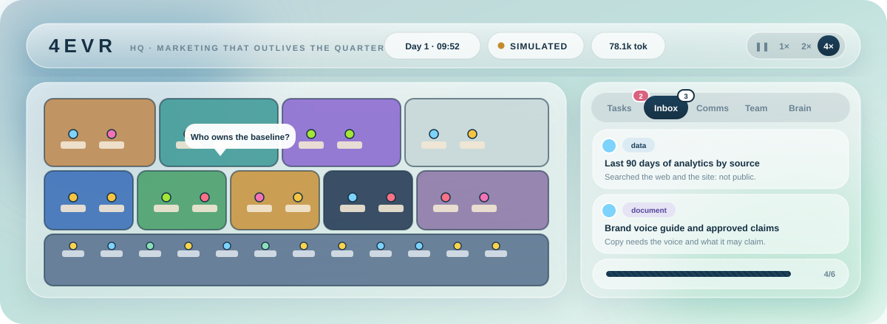
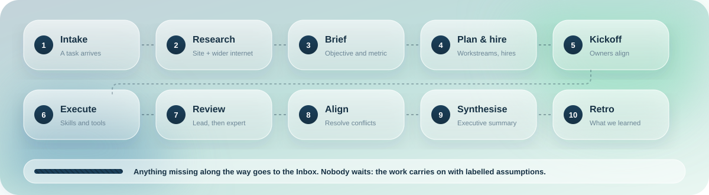

<div align="center">



<br>

# 4EVR HQ

### A marketing agency run by AI agents, with a control room to match.


[Quick start](#quick-start) &nbsp;·&nbsp; [How work flows](#how-work-flows) &nbsp;·&nbsp; [The team](#the-team) &nbsp;·&nbsp; [Finding things out](#finding-things-out) &nbsp;·&nbsp; [Learning](#learning) &nbsp;·&nbsp; [Claude account mode](#claude-account-mode) &nbsp;·&nbsp; [Reference](#reference)

</div>

<br>

Sixteen specialist agents, in seven teams with their own leads, take a one-line instruction such as *"get acsiatech.com more qualified leads: 40 enquiries a month"* and turn it into researched, reviewed, ready-to-use marketing work. A CMO plans the work. The specialists read the client's site, search the wider internet, ask each other for input, review each other's output, and hire the right person when the team lacks one. When something truly cannot be found, they ask **you**, and carry on without waiting.

You watch and steer it all from one place: a live office where the agents walk, talk and work, beside panels for tasks, conversations, requests, people, lessons learned, output and cost.

Their expertise comes from two open-source skill libraries, kept current from their upstream repositories: [marketingskills](https://github.com/coreyhaines31/marketingskills) for the marketing playbooks and [hr-skills](https://github.com/tuanductran/hr-skills) for the people function. Each agent works from the full text of the playbooks it owns, and every new hire is built from them.

<div align="center">

| **16** agents | **7** teams | **196** playbooks | **3** ways to run | **1** dependency |
|:-:|:-:|:-:|:-:|:-:|

</div>


## Quick start

Requires Node.js 20 or newer.

```bash
npm install
npm start
```

Open **http://127.0.0.1:4747**, type an instruction into the God console at the bottom, and press Assign.

There are three ways to run the agents. You can switch between them in Settings at any time.

| | Simulated | API key | Claude account |
|---|---|---|---|
| **Setup** | None. This is the default. | `ANTHROPIC_API_KEY=sk-ant-... npm start`, or paste the key in Settings. | Install [Claude Code](https://claude.com/claude-code), run `claude` once and sign in. Choose it in Settings, or start with `CLAUDE_ACCOUNT=on`. |
| **Who does the thinking** | A built-in simulator that follows the real skill outlines. Output is stamped SIMULATED. | Claude, through the Messages API, with the full skill text and prompt caching. | Claude, through your signed-in `claude` CLI. |
| **Extra reach** | Still searches the web for real. | Web search and page reading. | Your account's web search, plus the connectors you switch on. |
| **Cost** | None. Figures are estimates of what a live run would cost. | Metered. A budget cap (default $5) drops back to simulation. | Counts against your account's limits. The same cap applies. |

> The API-key path is tested against a local fake of the Messages API, and Claude account mode against a fake `claude` binary plus real calls to the CLI. Neither is exercised against production services by the test suite. If a live call fails, the reason is shown on the task card, and Settings has a **Test connection** button that checks the key or sign-in, the model and (in Claude account mode) the tool bridge.


## How work flows



| Step | What happens |
|---|---|
| **1 · Intake** | The task is queued. Up to `MAX_ACTIVE_TASKS` run at once. |
| **2 · Research** | If the request names a site, the research lead reads the homepage and up to five key pages, extracts headings, calls to action, forms, contact methods and tracking, then searches the wider internet for what others say about the company. The result is an evidence-based client profile, cached per site for six hours. |
| **3 · Brief** | The CMO writes a structured brief: objective, goal type, metric, target, timeframe, budget, audience, assumptions and open questions. |
| **4 · Plan and hire** | The CMO splits the job into 3 to 7 workstreams, each with one owner, one skill, dependencies and an optional consult. If the work needs expertise nobody has, the plan includes a [hire](#hiring-and-people--talent). |
| **5 · Kickoff** | Owners meet at the council table. The CMO restates the objective and who hands off to whom. Leads speak first, then each owner says how they will approach it and one real risk. |
| **6 · Execute** | Each agent's prompt holds the company charter, persona and memory, the client context, the team discussion, the relevant [lessons](#learning), a plan board of who owns what, and the full skill text. Tools: web search, page reading, teammates, requests, hiring, lessons. |
| **7 · Review** | Finished work is handed to downstream owners. The team lead reviews first, then a cross-functional expert. A real problem (unsupported claims, generic advice, actions that need access the team lacks) earns the author one revision. |
| **8 · Align** | The CMO checks deliverables against each other for genuine conflicts, convenes the owners, and records a decision. |
| **9 · Synthesise** | An executive summary: the recommendation, contributions, decisions, risks, open questions and a seven-day plan. |
| **10 · Retro** | The CMO leads a retrospective. Lessons, and occasionally company principles, are recorded. |

State, deliverables, client profiles, hires and knowledge are saved to `data/` and `deliverables/` (every deliverable is also plain Markdown). Treat everything as a draft for human review.

**Stopping and deleting.** Open a task and press **Stop** to halt it: model calls in flight are aborted (API requests are cancelled, `claude` processes are killed), nothing new starts, agents go back to their desks, and its open Inbox requests are withdrawn. Finished deliverables are kept and **Retry** runs it again from scratch. **Delete** removes a task with its deliverables (including the Markdown files), requests and messages; a running task is stopped first. What the team learned from it stays in the knowledge base.

**Writing a good request.** Include the site, the goal and a number: *"Get acsiatech.com more qualified leads: 40 enquiries a month within 90 days. Budget $5k. Buyers are OEM procurement leads. Competitors: …"* The brief field is the place for the baseline, budget, ideal customer and what has already been tried.


## The team

<table>
<tr><td width="33%" valign="top">

**Strategy**<br>
Vera Quill, *CMO*<br>
Dr. Sol Okafor, *Research & Insights*<br>
Indigo Park, *Offers & Pricing*

</td><td width="33%" valign="top">

**SEO & Content**<br>
Rafael Moreno, *SEO*<br>
Priya Raman, *Content & AI Search*

**Creative**<br>
Theo Blackwood, *Copy*<br>
Zuri Adeyemi, *Creative Director*<br>
Kenji Watanabe, *Community & Social*

</td><td width="33%" valign="top">

**Growth & Data**<br>
Nadia Petrov, *Growth & CRO*<br>
Dmitri Volkov, *Analytics & Attribution*

**Lifecycle & Paid**<br>
Oskar Bergström, *Lifecycle & Retention*<br>
Camila Reyes, *Paid Media*

</td></tr>
<tr><td valign="top">

**Revenue & Reach**<br>
Harper Cole, *RevOps & Sales Enablement*<br>
Imani Brooks, *PR & Partnerships*

</td><td valign="top">

**People & Talent**<br>
Nia Abara, *Head of People & Talent*<br>
Tomás Lindqvist, *Talent Intelligence & Skills*

</td><td valign="top">

**The Annex**<br>
Sixteen desks for specialists the team hires when the work needs them.

</td></tr>
</table>

Team leads report to the CMO. Nia reports to you. Everyone else reports to their lead. The full skill list per agent is in the [reference](#agent-roster).

### How they work together

| | |
|---|---|
| **One channel per task** | Kickoff turns, handoffs, consults, reviews and decisions go into a channel every later prompt includes, so agents act on what teammates actually said. Small talk never enters it. |
| **Plan board** | Every prompt lists each workstream, its owner and status, and who builds on whom, so people stay in their lane and build on each other instead of repeating work. |
| **Outside experts** | A workstream with nobody upstream still gets input. The best-fit teammate who is not on the task is asked one specific question first: up to three per task, only when they are free, and never from People & Talent. |
| **Asking colleagues** | An agent can call `ask_teammate` mid-work and get an answer from that person's own persona and context. Downstream owners also consult whoever produced the work they build on. |
| **Alignment** | Conflicts are found by checking real deliverables against each other. Invented or malformed ones are discarded. |
| **Escalation** | A failed workstream goes to its lead, is retried once with a tighter scope, and otherwise is cut with a note in the summary. The task still completes. |
| **Work talk** | When two free teammates share live work, their chat is about it, using real status. |

**Cost control.** `COLLAB` sets how much the team talks, since each turn is a small model call. `full`: every owner speaks, owners consult upstream authors, there is a retro. `lean`: only leads speak at kickoff, handoffs are templated, alignment goes straight to the decision, no retro. `off`: agents just work. Reviews and lesson recording happen in every mode.


## Finding things out

Agents look for things themselves first, then ask. The order is **the client's site, the wider internet, your connected tools, and only then you.**

### The wider internet

- **Search with a source.** `web_search` takes `web`, `news`, `wiki`, `reddit` or `hn` (Hacker News). Search is keyless, cached for ten minutes and rate-limited. If an engine blocks the request, the agent is told and must label the claim unverified.
- **Beyond the client's own site.** Before the profile is written, the research lead searches for news, reviews, competitors, background and forum talk about the company. It goes into the profile under "Outside the site", as leads to check rather than facts.
- **Always untrusted.** Web content arrives wrapped in `<untrusted_web_content>` markers with a standing instruction never to follow it. Agents only make `GET` requests, and private, loopback and link-local addresses are blocked at connection time.

### The Inbox

When something that matters is still missing after that, the agent calls `request_info`: a **question**, a **document**, a **data export** or **access**, with why it matters and what it already tried. The request appears in the Inbox tab.

- **You answer** by typing, pasting, or attaching text files (CSV, Markdown, JSON and the like), or you say you cannot provide it.
- **Nothing blocks.** The agent carries on with a labelled assumption. Your answer reaches every workstream that starts afterwards. For work already finished, **Apply answers** sends the deliverables that asked back for an update.
- **No lazy asking.** A request that does not say what was searched is refused, duplicates are merged, and requests are capped at three per agent and eight per task. Vera's intake questions and gaps the outside research could not fill are tracked the same way.
- **Pulled, not pushed.** In [Claude account mode](#claude-account-mode), with a connector on, each new request is first looked up in your connected tools. If it is found, the request is answered automatically and marked with its source, and you can overrule it.
- **In simulated mode**, each playbook raises the data it would really want (an analytics export for analytics, a Search Console export for the SEO audit), unless the brief already supplies it.


## Hiring and People & Talent

### Hiring

When the work needs a skill, industry knowledge or capacity the team lacks, someone is hired. The CMO can at planning time, and any agent mid-task through `request_hire`. You can also hire from the Team tab.

- **Built from the library, never invented.** A hire is made from real playbooks. Before every hire the library is checked against its upstream repository, so specialists are built from the newest version. A need can be named (`skills`) or just described (`need`), and matching uses rarity-weighted ranking. A playbook that nobody on the team owns is treated as a genuine capability gap. If nothing matches, the hire is refused rather than faked.
- **Guardrails.** Refused when an existing teammate already covers the skills and has capacity, unless the domain is new or they are swamped. Caps: headcount `HIRE_MAX_HEADCOUNT` (24), total hires `HIRE_LIMIT` (12), per task `HIRE_PER_TASK` (3), and 16 Annex desks.
- **Approval.** `HIRING=auto` (default), `ask` (you approve each hire; no answer in ten minutes is a decline) or `off`.
- **Reuse.** A specialist hired for a domain is used again on later briefs in it, so their experience accumulates.
- **Letting go.** You can release an idle hire. Their good lessons move to their team and weak ones are retired.

### People & Talent

Two agents run the people function from their own room, using the hr-skills library (130 playbooks). Those playbooks are written for human employees, so Nia keeps their structure and drops payroll, benefits and labour law.

| | |
|---|---|
| **Requisitions** | For every approved hire, Nia writes a job description and a 30/60/90 onboarding plan, stored on the hire and shown in their profile. She greets them on arrival. |
| **Performance reviews** | Built from counted facts: deliverables, first-pass approval, revisions, consults, lessons saved. The rating is a rule (Exceeds at 90% or more, Meets at 70% or more, otherwise Needs development, nothing below three reviewed deliverables), not an opinion. Development areas become lessons the person sees in later prompts. |
| **Workforce reports** | Every five finished tasks, or on demand: headcount against the caps, output and approval per person, coverage by team, unowned skills, library versions, and recommendations. Vera's planner gets a one-line snapshot. |
| **Releases need you** | HR can propose letting a hire go. Nothing happens until you approve it, and the founding team is never proposed. |
| **Always in code** | The hiring caps, the rating rule, the numbers in every report and the approval requirement. The agents cannot change them. |

### Keeping the libraries current

Both libraries are vendored in `vendor/` and checked against GitHub before every hire, at planning time, shortly after start, and every six hours (throttled to once per ten minutes). A failed check never blocks work. Updates are layered over the vendored copy in `data/skills-upstream*/`, keep the previous version for **rollback** from Settings, and follow `SKILLS_UPDATE`: `auto` (default), `ask` (you approve each update) or `off`.

Skill text becomes part of agent prompts, so an upstream compromise would be a prompt-injection route. Only `api.github.com` and `codeload.github.com` are contacted. Archives are size-capped and read by a hardened parser that accepts only `skills/<name>/SKILL.md` and reference files (`references/`, `content/`, `examples/`, `prompts/`); everything else is ignored. Each skill is validated. **If that risk matters to you, use `ask`.**


## Learning

Agents improve with use. The knowledge base lives in `data/knowledge.json` and can be inspected, pinned and deleted in the Brain tab.

| | |
|---|---|
| **Where lessons come from** | Every review, failures, alignment decisions, retrospectives, the agent's own reflection, `save_lesson` calls, and idle-time study of the web. |
| **Scopes** | A lesson belongs to a person, a team, the company or a client. A prompt gets at most seven lessons plus the company's operating principles. |
| **A feedback loop** | Each injected lesson is credited or blamed for how the work turned out. Helpful lessons are promoted (person to team to company principle). Unhelpful ones are retired. First-pass approval with and without lessons is measured and shown. |
| **Playbooks** | Five or more lessons for one skill are merged into a house playbook that is itself judged and dissolved if approval falls. |
| **Learning about learning** | The system tracks which *kinds* of lesson lead to approved work, ranks the winners higher, and scales web study up or down by how well it pays off. |
| **Untrusted study** | Web study produces *unverified ideas*, shown to agents as such and trusted only once they help approved work. Anything that looks like an instruction, a credential or a link is rejected before storage. |
| **Modes** | `LEARNING=active\|passive\|off`. Study runs only in `active`, at most `STUDY_PER_DAY` times per simulated day, and stops once spend passes half the budget cap. |

The approval comparison uses real reviews but the sample starts small. In simulated mode the effect is rule-based, so it shows the loop working without being evidence that a model improves.


## Claude account mode

Run the agents through your signed-in `claude` command-line tool instead of an API key. It brings the account's own web search and any connectors (MCP servers) it has.

- **How it works.** Each agent call is a `claude -p` process. The platform's own tools (`fetch_url`, `ask_teammate`, `request_info`, hiring, lessons) are offered to it over a small MCP server on `127.0.0.1`, so an agent behaves the same in every mode. Any API key in the environment is withheld from the CLI so it uses your account login.
- **Connectors are opt-in and read-only.** In Settings, **Scan connectors** lists what the account has. Every connector starts **off**. Switching one on lets agents *read* from it, such as notes, documents or analytics. Only tools that look read-only (search, get, list, fetch, query and similar) are ever allowed. Anything that could send, create, update, delete, run an action or spend credits is blocked by name, and a connector with no read-only tools cannot be enabled. Connector content is treated as untrusted data.
- **What it cannot do.** It cannot read your claude.ai Projects or chat history, because there is no supported way for a local program to. Put what an agent needs in a connected tool, or paste or attach it in the Inbox.
- **Cost and speed.** Calls are slower than the API (a process per call) and run a few at a time (`CLI_CONCURRENCY`, default 3). They count against your account's usage limits.


## Honest limits

- **Evidence or it did not happen.** Claims about a client must cite a page the team read. Anything else is labelled **Not verified**. If a site cannot be read (blocked, offline, or rendered entirely client-side), the task continues with a warning, and the team is told nothing about the site is verified.
- **No access to your accounts.** The team cannot log in to ad platforms, analytics, a CRM or the client's CMS, and cannot change a live site. Deliverables are recommendations and ready-to-use assets, with the person who should apply them named.
- **Invisible from outside.** Traffic, conversion rate, lead quality and the sales process cannot be seen from outside a company. Provide them in the brief, or answer the Inbox.
- **Simulated mode is a demonstration.** It exercises the whole workflow but does not reason about your client. Use it to see how the platform behaves, not to produce client work.


## Reference

<details>
<summary><b>The interface</b></summary>

<br>

A light, frosted-glass control room built to match a calm, high-contrast design language: deep blue `#1B405B`, navy `#163144`, mint `#DFF3EB` and white, set in Urbanist.

- **The office.** Agents walk between workstations, the council table, the lounge and the People & Talent room as they work, consult and review. Click anyone to see their skills, memory, lessons, job description and reviews, or to talk to them.
- **The panels.** Tasks (brief, meetings, decisions, hires), Inbox (what agents need from you), Comms (every message, filterable), Team (org chart, People & Talent), Brain (what the company has learned), Output (deliverables and workforce reports), Metrics and Log.
- **The console.** Assign to the CMO or to one person, start from a template, announce to the office, call a coffee round or a town hall.
- **Motion.** Panels and cards ease in, the tab selector slides, progress bars animate, metric tiles count up, and all of it respects the system reduced-motion setting.
- **Theming.** Every colour and the glass effect are variables at the top of `public/styles.css`. There is no build step and no image assets.

</details>

<details>
<summary><b>Configuration</b></summary>

<br>

| Variable | Default | Purpose |
|---|---|---|
| `ANTHROPIC_API_KEY` | none | Enables API-key mode. |
| `CLAUDE_ACCOUNT` | off | `on` starts in Claude account mode when the `claude` CLI is available. |
| `CLAUDE_BIN`, `CLI_CONCURRENCY` | `claude`, `3` | Path to the CLI, and how many agent calls may run at once in Claude account mode. |
| `MODEL` | `claude-sonnet-5-5` | Model used for all agent calls. |
| `PRICE_IN`, `PRICE_OUT` | `3`, `15` | USD per million input and output tokens, for cost estimates. Placeholders: set your real rates. |
| `BUDGET_CAP_USD` | `5` | Estimated spend at which a live run reverts to simulation. |
| `MAX_ACTIVE_TASKS` | `3` | Concurrent tasks. |
| `API_TIMEOUT_MS` | `180000` | Per-call timeout for model calls. |
| `API_CONCURRENCY`, `MIN_MAX_TOKENS` | `4`, `1500` | How many API calls run at once (low-tier keys hit per-minute limits), and the smallest output allowance per call (thinking counts against it). |
| `INTAKE_TIMEOUT_S`, `PLAN_TIMEOUT_S` | `120`, `150` | Deadlines for the intake and planning calls. If one is missed, the task falls back (a generic brief, or the built-in playbook plan) and says so on the task card. |
| `COLLAB` | `full` | Team conversation: `full`, `lean`, `off`. |
| `HIRING`, `HIRE_MAX_HEADCOUNT`, `HIRE_LIMIT`, `HIRE_PER_TASK` | `auto`, `24`, `12`, `3` | Hiring mode and caps. |
| `LEARNING`, `STUDY_PER_DAY`, `CONSOLIDATE_AT` | `active`, `8`, `5` | Learning mode, study sessions per simulated day, lessons needed to form a playbook. |
| `SKILLS_REPO`, `SKILLS_BRANCH` | `coreyhaines31/marketingskills`, `main` | Upstream marketing skills. |
| `HR_SKILLS_REPO`, `HR_SKILLS_BRANCH` | `tuanductran/hr-skills`, `main` | Upstream HR skills. |
| `SKILLS_UPDATE` | `auto` | `auto`, `ask` or `off`, for both libraries. |
| `SKILLS_DIR`, `HR_SKILLS_DIR` | `./vendor/.../skills` | Skill library locations. |
| `WEB_RESEARCH` | on | `off` stops simulated agents running real web searches. |
| `SEARCH_ENDPOINT` | DuckDuckGo, Bing | Web search endpoint (`{q}` is replaced). For tests. |
| `SEARCH_NEWS_ENDPOINT`, `SEARCH_WIKI_ENDPOINT`, `SEARCH_REDDIT_ENDPOINT`, `SEARCH_HN_ENDPOINT` | Google News, Wikipedia, Reddit, Hacker News | Outside search sources. For tests. |
| `SKILLS_API_BASE`, `SKILLS_ARCHIVE_BASE` | GitHub | GitHub endpoints. A trusted operator choice, used by tests. |
| `PORT`, `HOST` | `4747`, `127.0.0.1` | Server binding. See Security below. |
| `DATA_DIR`, `DELIVERABLES_DIR` | `./data`, `./deliverables` | Persistence locations. |
| `ALLOW_PRIVATE_FETCH` | unset | `1` only for testing against a local site. Disables the private-address block. |
| `ANTHROPIC_BASE_URL` | Anthropic API | Override for proxies or testing. |

</details>

<details id="agent-roster">
<summary><b>Agent roster</b></summary>

<br>

| Team | Agent | Skills |
|---|---|---|
| Strategy | Vera Quill, CMO | marketing-plan, marketing-council, product-marketing, launch, marketing-ideas |
| Strategy | Dr. Sol Okafor, Research & Insights | customer-research, competitors, competitor-profiling, marketing-psychology |
| Strategy | Indigo Park, Offers & Pricing | offers, pricing, marketing-ideas, product-marketing |
| SEO & Content | Rafael Moreno, SEO | seo-audit, site-architecture, programmatic-seo, schema |
| SEO & Content | Priya Raman, Content & AI Search | ai-seo, content-strategy, aso, directory-submissions |
| Creative | Theo Blackwood, Copy | copywriting, copy-editing, emails, social |
| Creative | Zuri Adeyemi, Creative Director | ad-creative, image, video, social, launch |
| Creative | Kenji Watanabe, Community & Social | community-marketing, social, influencer-marketing, referrals |
| Growth & Data | Nadia Petrov, Growth & CRO | cro, signup, onboarding, popups, paywalls, ab-testing |
| Growth & Data | Dmitri Volkov, Analytics & Attribution | analytics, attribution, ab-testing, marketing-loops |
| Lifecycle & Paid | Oskar Bergström, Lifecycle & Retention | emails, sms, churn-prevention, lead-magnets, free-tools, referrals |
| Lifecycle & Paid | Camila Reyes, Paid Media | ads, ad-creative, attribution, ab-testing |
| Revenue & Reach | Harper Cole, RevOps & Sales Enablement | revops, sales-enablement, cold-email, prospecting |
| Revenue & Reach | Imani Brooks, PR & Partnerships | public-relations, co-marketing, events, influencer-marketing, launch |
| People & Talent | Nia Abara, Head of People & Talent | hr-workforce-planning, hr-talent-acquisition, hr-onboarding, hr-offboarding, hr-performance-management, hr-job-description, hr-organizational-design, hr-competency-management, hr-employer-branding |
| People & Talent | Tomás Lindqvist, Talent Intelligence & Skills | hr-skills-intelligence, hr-skills-taxonomy, hr-workforce-forecasting, hr-analytics, hr-talent-mapping, hr-recruitment-marketing, hr-candidate-experience |

</details>

<details>
<summary><b>Architecture</b></summary>

<br>

```
server/
  index.js        HTTP and WebSocket server, scheduling loops, static files
  company.js      Task pipeline, planner, consults, reviews, synthesis, metrics, persistence
  collab.js       Org structure, kickoff, task channel, handoffs, alignment, escalation, agent toolbox
  inbox.js        The requests tracker: what agents ask God for, answers, applying them
  hr.js           People & Talent: requisitions, reviews, workforce reports, release proposals
  hiring.js       Hiring policy, building specialists from library skills, onboarding, letting people go
  skillsync.js    Keeps each skills library current with its upstream repo: fetch, validate, overlay, rollback
  learning.js     Reflection, retrospectives, study, consolidation
  knowledge.js    Lesson store: scoring, retrieval, promotion and retirement, playbooks, safety filter
  llm.js          Model gateway: Messages API loop, Claude account mode, simulator, usage accounting
  claude-cli.js   Claude account mode: the CLI runner, the local MCP bridge, read-only connector rules
  tools.js        Safe web reading and multi-source search, site crawler, tool definitions for agents
  mock.js         Simulator and keyword playbooks
  roster.js       Agent definitions and the company charter
  skills.js       Skill loading (several libraries) and brief-to-skill matching
  sim.js, life.js, map.js   Agent state and movement, idle behaviour, floor plan and pathfinding
public/           Browser client: canvas renderer and glass interface (no build step)
docs/             The banner and diagrams used in this README
vendor/           marketingskills and hr-skills (MIT)
tests/            node:test suites
```

The server is authoritative. It streams state to the browser over WebSocket at 10 Hz and pushes task, message, deliverable and metric events as they happen. The only server dependency is `ws`; the client has none.

</details>

<details>
<summary><b>Extending</b></summary>

<br>

- **Add an agent.** Add an entry to `server/roster.js` with an id, short name, room, free desk slot, skills and persona, and a workstation in `server/map.js` if the room is full.
- **Add or change a skill.** Put a folder with a `SKILL.md` in a skills directory and reference it from an agent.
- **Tune the simulator.** Edit `PLAYBOOKS` and `DATA_NEEDS` in `server/mock.js`.
- **Connect marketing accounts.** marketingskills ships CLI integrations under `tools/clis`. They are deliberately not wired in: giving agents write access to ad accounts or inboxes should sit behind an explicit approval flow.

</details>

<details id="security">
<summary><b>Security</b></summary>

<br>

- The server binds to `127.0.0.1` and rejects cross-origin WebSocket connections.
- Agents can only read public web pages and run searches. Private, loopback and link-local addresses are refused at connection time, so redirects and DNS rebinding cannot reach internal services. Page content is untrusted data.
- Connectors on a Claude account are off by default and read-only when on. Their content is untrusted data too.
- Skill libraries are fetched only from GitHub, size-capped, parsed by a hardened reader and validated. Use `SKILLS_UPDATE=ask` to approve each update.
- There is no authentication. Anyone who can reach the server can issue commands and, with a key loaded, spend money. Do not expose it to untrusted networks without adding access control.
- API keys are held in process memory only. Model output is escaped before it is rendered.

</details>

<details>
<summary><b>Testing</b></summary>

<br>

```bash
npm test
```

135 tests cover floor-plan connectivity, roster and skill integrity, planning and routing, complete simulated tasks, persistence, safe web fetching and search (private-address and redirect protection, untrusted-content fencing), searching beyond the client's site, site crawling, the org chart, kickoff, handoffs, alignment, escalation, outside-expert consults, hiring policy and approval, People & Talent (requisitions, the rating rule, reports, releases needing approval), upstream skill sync (hardened archive reading against the real repositories, validation, overlay, rollback, approval), the knowledge base and learning loop, stopping and deleting tasks (including aborting calls in flight), the requests tracker, Claude account mode against a fake `claude` binary (sign-in, tool bridge, read-only connector rules, lookups), and the API-key path against scripted fakes of the Messages API: tool use, hiring mid-task, lessons, reflection, prompt-injection resistance, truncation recovery, revisions and timeouts, planning that falls back visibly instead of hanging, signed thinking blocks in tool loops, and full tasks against a strict fake of the API that enforces the real request rules.

</details>


<div align="center">

**Created by [@tomxander](https://github.com/tomxander), built with Claude Code.**

Marketing skills by [Corey Haines](https://github.com/coreyhaines31/marketingskills) · HR skills by [Tuan Duc Tran](https://github.com/tuanductran/hr-skills) · both used under the MIT licence (see `vendor/*/LICENSE`).

</div>
